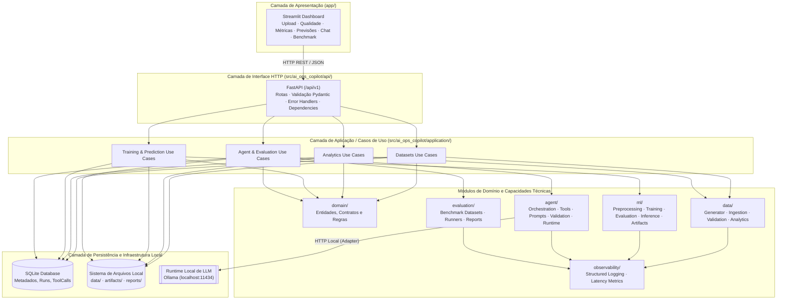
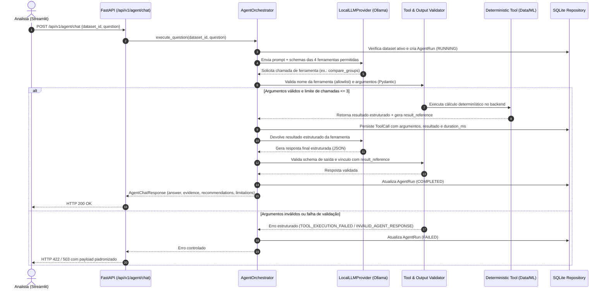
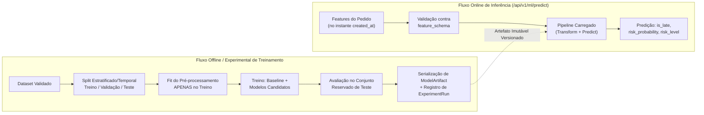
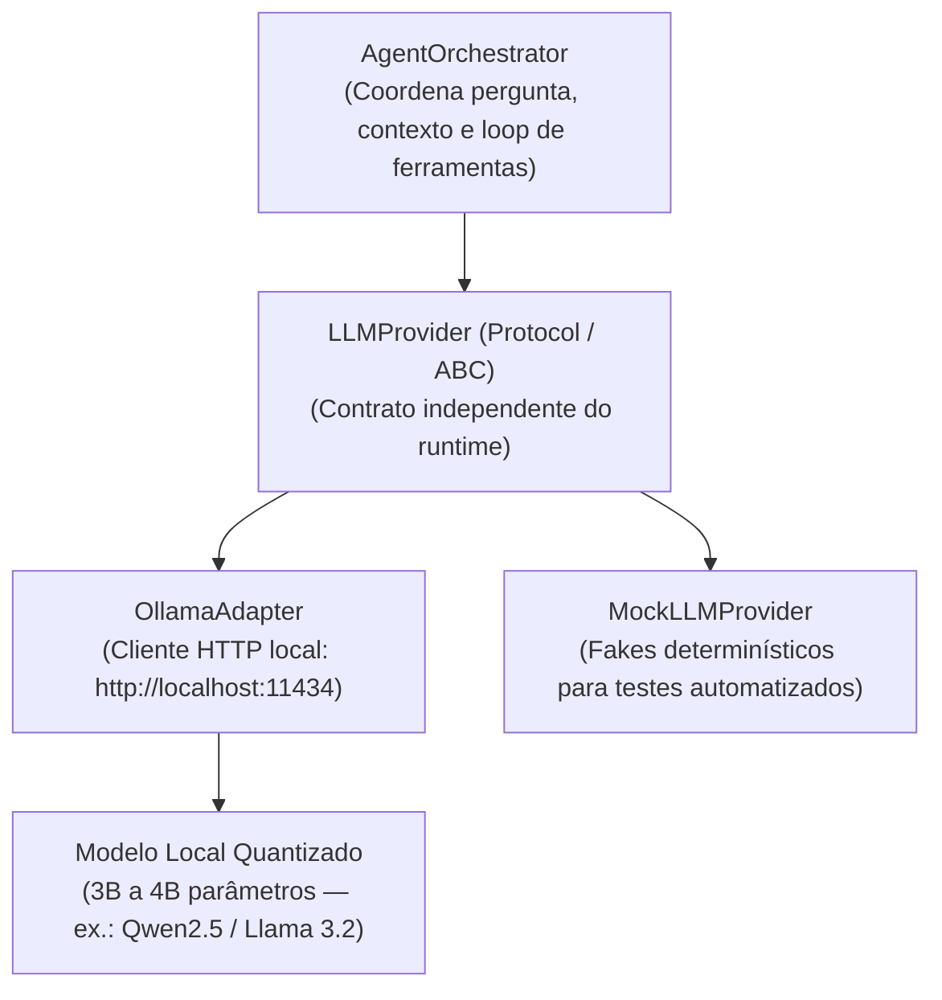
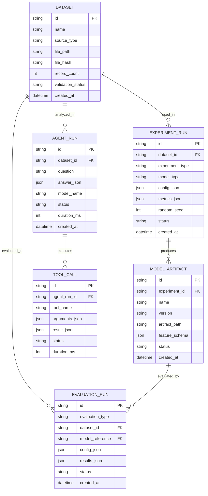

# AI Ops Copilot — Arquitetura de Software e Contratos Técnicos (Fase 0)

> **Status:** Fase 0 — Arquitetura Consolidada do MVP  
> **Versão:** 1.0.0  
> **Estilo Arquitetural:** Monólito Modular em Python  
> **Stack Principal:** Python · FastAPI · Streamlit · Pydantic · pandas · scikit-learn · SQLite · Ollama · pytest

---

## 1. Visão Geral e Princípios Arquiteturais

O **AI Ops Copilot** adota uma arquitetura de **Monólito Modular em Python**, exposta por uma API REST (**FastAPI**) e consumida por uma interface analítica (**Streamlit**).

### 1.1. Princípios Norteadores
1. **IA como Componente Controlado:** O LLM local atua exclusivamente como interpretador de intenção, seletor de ferramentas permitidas e sintetizador de respostas fundamentadas. Cálculos, agregações e predições são executados deterministicamente pelo backend.
2. **Fronteiras Explícitas e Desacopladas:** Um único repositório e processo de backend, porém internamente particionado em camadas com contratos tipados via **Pydantic**, evitando acoplamento entre interface visual, regras de negócio, modelos de ML e provedor de LLM.
3. **Treinamento Separado da Inferência:** O treinamento de modelos (`ml.training`) é um caso de uso assíncrono/experimental que produz artefatos imutáveis (`ModelArtifact`). A inferência (`ml.inference`) apenas carrega artefatos aprovados e executa predições rápidas.
4. **Execução 100% Local e Privada:** Toda a pilha (API, banco SQLite, armazenamento de CSVs/modelos e runtime de LLM via Ollama) executa em `localhost`, sem envio de dados ou prompts a APIs externas.
5. **Reprodutibilidade Científica:** Sementes aleatórias (`random_seed`), hashes SHA-256 de datasets, configurações de treino e versões de modelos são persistidos para permitir auditoria e repetição exata de experimentos.

---

## 2. Diagramas de Arquitetura

### 2.1. Visão em Camadas e Fluxo de Dependências



### 2.2. Fluxo de Execução de uma Pergunta ao Agente



### 2.3. Pipeline de Treinamento vs. Inferência de Machine Learning



---

## 3. Estrutura do Repositório e Camadas

### 3.1. Árvore de Diretórios Definitiva

```text
ai-ops-copilot/
│
├── app/
│   └── dashboard.py
│
├── src/
│   └── ai_ops_copilot/
│       ├── api/
│       │   ├── routes/
│       │   ├── dependencies.py
│       │   └── error_handlers.py
│       │
│       ├── application/
│       │   ├── datasets/
│       │   ├── analytics/
│       │   ├── training/
│       │   ├── prediction/
│       │   └── agent/
│       │
│       ├── domain/
│       │   ├── datasets/
│       │   ├── orders/
│       │   ├── models/
│       │   └── agent/
│       │
│       ├── data/
│       │   ├── generator/
│       │   ├── ingestion/
│       │   ├── validation/
│       │   └── analytics/
│       │
│       ├── ml/
│       │   ├── preprocessing/
│       │   ├── training/
│       │   ├── evaluation/
│       │   ├── inference/
│       │   └── artifacts/
│       │
│       ├── agent/
│       │   ├── runtime/
│       │   ├── prompts/
│       │   ├── tools/
│       │   ├── orchestration/
│       │   └── validation/
│       │
│       ├── evaluation/
│       │   ├── datasets/
│       │   ├── benchmarks/
│       │   └── reports/
│       │
│       ├── persistence/
│       │   ├── database/
│       │   ├── repositories/
│       │   └── files/
│       │
│       └── observability/
│           ├── logging.py
│           └── metrics.py
│
├── data/
│   ├── generated/
│   └── samples/
│
├── artifacts/
│   ├── models/
│   └── reports/
│
├── experiments/
├── tests/
│   ├── unit/
│   ├── integration/
│   └── end_to_end/
│
├── docs/
│   ├── requirements.md
│   ├── architecture.md
│   ├── data_dictionary.md
│   ├── ml_experiments.md
│   └── agent_evaluation.md
│
├── scripts/
├── pyproject.toml
├── .env.example
├── .gitignore
└── README.md
```

### 3.2. Responsabilidades e Limites de Cada Camada

| Camada / Módulo | Responsabilidade Principal | O Que NÃO Deve Fazer |
|---|---|---|
| `domain` | Definir entidades centrais, enums de estado, regras de atraso e contratos de valor. | Importar frameworks web (`fastapi`, `streamlit`), clientes HTTP ou bibliotecas de banco. |
| `application` | Orquestrar casos de uso combinando domínio, serviços técnicos e repositórios. | Conter detalhes de formatação visual ou lógica SQL bruta. |
| `data` | Gerar dados sintéticos, ingerir CSVs, validar qualidade e calcular agregações em `pandas`/`numpy`. | Gerar texto em linguagem natural ou chamar o LLM. |
| `ml` | Pré-processar atributos permitidos, treinar baseline/candidatos, avaliar métricas e executar inferência. | Acessar diretamente rotas HTTP ou retreinar modelos durante chamadas de predição. |
| `agent` | Gerenciar o adaptador do LLM local, expor ferramentas permitidas, orquestrar chamadas e validar evidências. | Calcular métricas por conta própria ou executar código/SQL arbitrário. |
| `evaluation` | Executar benchmarks reproduzíveis de ML e do agente (30 perguntas) e consolidar relatórios. | Alterar gabaritos de referência para favorecer o modelo avaliado. |
| `persistence` | Gerenciar conexão SQLite, repositórios transacionais e leitura/escrita controlada em disco. | Conter regras de negócio de classificação ou validação estatística. |
| `api` | Expor contratos HTTP REST (`/api/v1`), validar payloads e mapear exceções de domínio para códigos HTTP. | Concentrar regras de negócio ou cálculos nos *controllers* das rotas. |
| `observability` | Prover logs estruturados e medição padronizada de tempo de execução (`duration_ms`). | Registrar dados sensíveis, segredos ou dumps integrais desnecessários. |
| `app` | Apresentar fluxos interativos em Streamlit consumindo a API. | Acessar o banco SQLite diretamente ou reimplementar cálculos do backend. |

---

## 4. Arquitetura do LLM Local e do Agente

### 4.1. Desacoplamento do Runtime Local



- **Escolha Empírica do Modelo Local:** O sistema não fica acoplado a um único peso de modelo. A seleção entre modelos quantizados de 3B a 4B parâmetros será guiada por bateria de testes no hardware disponível (ex.: Ryzen 5 5500 + 16 GB RAM + RX 5500 XT ou Ryzen 7 5825U + 16 GB RAM), avaliando:
  1. Precisão na escolha de ferramentas e formatação de argumentos.
  2. Capacidade de respeitar o schema JSON de saída.
  3. Latência de inferência e consumo de RAM/VRAM (testando execução em CPU e GPU quando suportado).
- **Garantia de Privacidade:** O endpoint configurado no adaptador deve apontar exclusivamente para endereços locais (`localhost` / `127.0.0.1`). Não haverá *fallback* para APIs remotas.

### 4.2. Catálogo Fechado de Ferramentas do Agente

O agente só pode solicitar a execução das quatro ferramentas registradas abaixo:

| Nome Lógico | Argumentos de Entrada (Validados via Pydantic) | Saída Determinística |
|---|---|---|
| `get_overview` | `dataset_id: str` | Volume total de pedidos, registros válidos, taxa global de atraso (`late_rate`), ticket médio, tempo médio estimado e real de preparo/entrega. |
| `compare_groups` | `dataset_id: str`, `group_by: Literal["hour_of_day", "day_of_week", "region", "order_category"]`, `metric: Literal["late_rate", "order_count", "avg_delivery_minutes", "avg_prep_minutes", "avg_order_value"]`, `filters: Optional[dict]` | Lista ordenada de grupos contendo chave do grupo (`group`), valor calculado (`value`) e tamanho da amostra (`sample_count`). |
| `predict_delay_risk` | `model_id: Optional[str]`, `features: OrderPredictionFeatures` (`hour_of_day`, `day_of_week`, `region`, `order_category`, `order_value`, `estimated_prep_minutes`, `estimated_delivery_minutes`) | `is_late` (`bool`), `risk_probability` (`float`), `risk_level` (`low`, `medium`, `high`) e `model_version` (`str`). |
| `get_model_evaluation` | `model_id: Optional[str]`, `experiment_id: Optional[str]` | Métricas de avaliação no conjunto de teste (Precision, Recall, F1-score, PR-AUC, matriz de confusão) e comparação com a *baseline*. |

### 4.3. Controles de Segurança e Confiabilidade do Agente
- **Allowlist Estrita:** Qualquer tentativa do LLM de invocar ferramenta fora das 4 registradas é bloqueada pelo validador.
- **Limite de Iterações:** Máximo de **3 chamadas de ferramentas** por pergunta do usuário para evitar loops infinitos.
- **Prevenção de *Prompt Injection*:** Conteúdos textuais e retornos de ferramentas são encapsulados como blocos de dados, nunca interpretados como instruções de sistema capazes de alterar permissões.
- **Estrutura Epistemológica da Resposta:**
  - **Fato:** Valor retornado pela ferramenta e vinculado via `result_reference`.
  - **Interpretação:** Leitura direta da comparação entre grupos ou métricas.
  - **Hipótese:** Possível explicação operacional marcada explicitamente com `type: "hypothesis"`.
  - **Recomendação:** Próximo passo investigativo sugerido ao analista.
  - **Limitação:** Avisos obrigatórios (ex.: dados sintéticos, tamanho amostral reduzido ou variáveis não observadas).

---

## 5. Contratos da API REST (`/api/v1`)

Todas as rotas utilizam prefixo `/api/v1`, comunicação JSON e validação automática via Pydantic.

### 5.1. Datasets e Qualidade (`/datasets`)

| Método | Endpoint | Responsabilidade |
|---|---|---|
| `POST` | `/api/v1/datasets` | Importar arquivo CSV externo |
| `POST` | `/api/v1/datasets/generate` | Gerar novo dataset sintético reproduzível |
| `GET` | `/api/v1/datasets` | Listar datasets registrados |
| `GET` | `/api/v1/datasets/{dataset_id}` | Consultar metadados de um dataset |
| `POST` | `/api/v1/datasets/{dataset_id}/validate` | Executar validação estrutural e de domínio |
| `GET` | `/api/v1/datasets/{dataset_id}/quality` | Obter relatório detalhado de qualidade |

**Exemplo — `POST /api/v1/datasets/generate`:**
```json
// Request
{
  "number_of_orders": 10000,
  "random_seed": 42,
  "late_tolerance_minutes": 5
}

// Response (201 Created)
{
  "dataset_id": "ds_001",
  "status": "created",
  "records": 10000,
  "random_seed": 42,
  "late_tolerance_minutes": 5
}
```

**Exemplo — `GET /api/v1/datasets/{dataset_id}/quality`:**
```json
{
  "dataset_id": "ds_001",
  "total_records": 10000,
  "valid_records": 9980,
  "invalid_records": 20,
  "warnings": [
    {
      "field": "order_value",
      "issue": "missing_values",
      "count": 12
    }
  ],
  "status": "completed"
}
```

### 5.2. Análise Operacional (`/analytics`)

| Método | Endpoint | Responsabilidade |
|---|---|---|
| `GET` | `/api/v1/analytics/overview` | Indicadores operacionais globais do dataset |
| `GET` | `/api/v1/analytics/late-rate` | Estatísticas detalhadas de taxa de atraso |
| `GET` | `/api/v1/analytics/groups` | Comparação de métricas agrupadas por dimensão |

**Exemplo — `GET /api/v1/analytics/groups?dataset_id=ds_001&group_by=hour_of_day&metric=late_rate`:**
```json
{
  "dataset_id": "ds_001",
  "group_by": "hour_of_day",
  "metric": "late_rate",
  "results": [
    {
      "group": "12",
      "value": 0.23,
      "sample_count": 850
    }
  ]
}
```

### 5.3. Machine Learning (`/ml`)

| Método | Endpoint | Responsabilidade |
|---|---|---|
| `POST` | `/api/v1/ml/experiments` | Iniciar experimento de treino e avaliação (baseline + candidato) |
| `GET` | `/api/v1/ml/experiments/{experiment_id}` | Consultar status e metadados do experimento |
| `GET` | `/api/v1/ml/experiments/{experiment_id}/metrics` | Consultar métricas comparativas detalhadas |
| `GET` | `/api/v1/ml/models` | Listar artefatos de modelos disponíveis para inferência |
| `POST` | `/api/v1/ml/predict` | Estimar risco de atraso para um pedido |

**Exemplo — `POST /api/v1/ml/predict`:**
```json
// Request
{
  "model_id": "delay_classifier_v1",
  "features": {
    "hour_of_day": 19,
    "day_of_week": 5,
    "region": "north",
    "order_category": "restaurant",
    "order_value": 65.90,
    "estimated_prep_minutes": 25,
    "estimated_delivery_minutes": 35
  }
}

// Response (200 OK)
{
  "model_id": "delay_classifier_v1",
  "prediction": {
    "is_late": true,
    "risk_probability": 0.78,
    "risk_level": "high"
  },
  "model_version": "1.0.0"
}
```

### 5.4. Agente de IA (`/agent`)

| Método | Endpoint | Responsabilidade |
|---|---|---|
| `POST` | `/api/v1/agent/chat` | Enviar pergunta em linguagem natural ao agente |
| `GET` | `/api/v1/agent/runs/{run_id}` | Consultar trilha completa da execução e ferramentas chamadas |
| `GET` | `/api/v1/agent/health` | Verificar conectividade e modelo ativo no runtime local |

**Exemplo — `POST /api/v1/agent/chat`:**
```json
// Request
{
  "dataset_id": "ds_001",
  "question": "Qual horário apresenta a maior taxa de atraso?"
}

// Response (200 OK)
{
  "run_id": "run_001",
  "status": "completed",
  "answer": "A faixa horária com maior taxa de atraso foi...",
  "evidence": [
    {
      "tool": "compare_groups",
      "metric": "late_rate",
      "group": "hour_of_day",
      "result_reference": "evidence_001"
    }
  ],
  "recommendations": [
    {
      "text": "Investigar a capacidade operacional e o tempo estimado nessa faixa horária.",
      "type": "hypothesis"
    }
  ],
  "limitations": [
    "Os dados utilizados são sintéticos."
  ],
  "model": {
    "provider": "local",
    "name": "configured-model"
  }
}
```

### 5.5. Avaliação e Benchmark (`/evaluation`)

| Método | Endpoint | Responsabilidade |
|---|---|---|
| `POST` | `/api/v1/evaluation/ml` | Executar bateria de avaliação de ML |
| `POST` | `/api/v1/evaluation/agent` | Executar benchmark das 30 perguntas do agente |
| `GET` | `/api/v1/evaluation/runs/{run_id}` | Consultar status e sumário da avaliação |
| `GET` | `/api/v1/evaluation/runs/{run_id}/report` | Obter relatório consolidado da avaliação |

### 5.6. Contrato Padronizado de Erros

Qualquer falha de validação, regra de negócio ou infraestrutura retorna um envelope JSON uniforme, sem expor *stack traces*, caminhos absolutos do sistema operacional ou segredos:

```json
{
  "error": {
    "code": "DATASET_NOT_VALIDATED",
    "message": "O dataset precisa ser validado antes desta operação.",
    "details": {
      "dataset_id": "ds_001"
    }
  }
}
```

**Catálogo Inicial de Códigos de Erro:**

| Código de Erro | HTTP Status | Cenário de Ocorrência |
|---|---:|---|
| `INVALID_FILE_FORMAT` | `400` / `422` | Arquivo enviado não é um CSV válido ou possui estrutura ilegível. |
| `DATASET_NOT_FOUND` | `404` | O `dataset_id` informado não existe no repositório. |
| `DATASET_NOT_VALIDATED` | `409` | Tentativa de analisar, treinar ou consultar agente sobre dataset ainda não validado. |
| `INVALID_FEATURES` | `422` | Atributos ausentes, tipos incorretos ou categorias desconhecidas na inferência. |
| `MODEL_NOT_FOUND` | `404` | O `model_id` solicitado não foi encontrado. |
| `MODEL_NOT_TRAINED` | `409` | Solicitação de inferência quando nenhum modelo foi treinado/aprovado. |
| `LLM_UNAVAILABLE` | `503` | Runtime local (Ollama) desligado, inacessível ou em timeout. |
| `TOOL_EXECUTION_FAILED` | `422` / `500` | Falha na validação de argumentos ou na execução de uma ferramenta do agente. |
| `INVALID_AGENT_RESPONSE` | `502` | O LLM local retornou estrutura fora do contrato ou sem evidência correspondente. |
| `EVALUATION_FAILED` | `500` | Erro durante a execução de uma rodada de benchmark. |

---

## 6. Modelo de Persistência Híbrido

A persistência combina **SQLite** (para metadados transacionais e rastreabilidade) e **Arquivos Locais** (para datasets CSV, modelos serializados e relatórios).

### 6.1. Diagrama Entidade-Relacionamento (SQLite)



### 6.2. Regras Invariantes de Persistência
1. Todo `Dataset` possui identificador único e hash SHA-256 (`file_hash`) calculado sobre o arquivo bruto.
2. Todo `ExperimentRun` referencia obrigatoriamente o `dataset_id`, a semente (`random_seed`) e o dicionário completo de parâmetros (`config_json`).
3. Nenhum `ModelArtifact` pode ser registrado sem vínculo válido ao `ExperimentRun` que o produziu.
4. Todo `ModelArtifact` ativo para inferência armazena seu `feature_schema` explícito para validação pré-predição.
5. Todo `AgentRun` registra o nome/identificador do modelo local utilizado e todas as `ToolCall`s acionadas na sessão.
6. Todo `EvaluationRun` preserva de forma imutável a configuração e o resultado detalhado por categoria.
7. Artefatos em disco (`artifacts/models/`, `artifacts/reports/`) utilizam nomes versionados/únicos e jamais sobrescrevem execuções anteriores.

---

## 7. Registro de Decisões Arquiteturais (ADRs)

| ID | Decisão | Escolha Adotada | Justificativa Técnica |
|---|---|---|---|
| **ADR-01** | Estilo Arquitetural | Monólito Modular em Python | Elimina a sobrecarga operacional de múltiplos serviços distribuídos, mantendo separação rigorosa de pacotes e contratos internos claros. |
| **ADR-02** | Framework de API e Validação | FastAPI + Pydantic | Geração automática de documentação OpenAPI, validação declarativa forte de entradas/saídas e excelente suporte a testes de contrato. |
| **ADR-03** | Interface de Usuário | Streamlit | Permite construir rapidamente uma interface analítica funcional para demonstração ponta a ponta, mantendo o foco de engenharia no backend, ML e agente. |
| **ADR-04** | Banco de Dados de Metadados | SQLite | Zero configuração de servidor externo, totalmente portátil em Windows/Linux e ideal para armazenar metadados, histórico de experimentos e auditoria de execuções locais. |
| **ADR-05** | Processamento e ML | pandas, NumPy e scikit-learn | Ferramentas padrão da indústria para dados tabulares e pipelines supervisionados reproduzíveis (`Pipeline`, `ColumnTransformer`), sem complexidade desnecessária de *deep learning*. |
| **ADR-06** | Runtime de LLM Local | Adaptador Local (inicialmente Ollama) | Garante execução gratuita e 100% privada (`localhost`), permitindo testar diferentes modelos quantizados (3B–4B) através de uma abstração `LLMProvider`. |
| **ADR-07** | Estratégia de Avaliação do Agente | Benchmark Determinístico Próprio (30 perguntas) | Em vez de usar um LLM para julgar outro LLM sem controle, compara-se a resposta do agente diretamente contra gabaritos calculados pelas funções determinísticas do sistema. |

